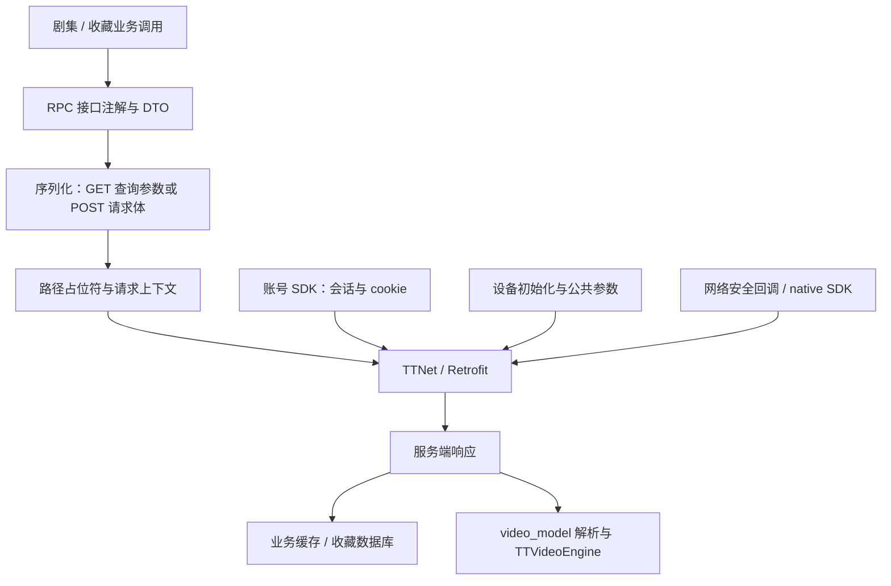

# 红果 6.2.3.32 与 7.4.1.32 通信机制对照

日期：2026-10-22 UTC。目标是理解登录、收藏、播放及其共同网络层，为 HG-ATV 后续接入提供依据。**旧版确实让业务链更容易定位；目前已确认接口声明、调用者、主要 DTO、GET 展开和会话桥接，尚未完成可独立复用的 App 登录/收藏/播放协议。**

用户在自己的手机上验证旧版三项功能正常，是用户侧运行观察。本次做下载身份核对、REA 聚焦反编译与原 DEX 指令对照，没有在手机注入、启动原 APK、登录账号、发送短信或修改收藏。以下将静态事实与服务端成功验收分开记录。

## 样本来源和身份

旧包来自用户指定[豌豆荚历史页面](https://m.wandoujia.com/apps/8396801/history_v62332)：解析锚点文字严格等于 **“普通下载”** 的元素，使用其 `data-href` 下载 APK。下载正文为 71,781,163 字节，页面 MD5 `2633e3ff177ee11fd648ddada6e749ff` 与文件相符，未使用“安全下载”助手。Manifest 为 `com.phoenix.read`，6.2.3.32 / 62332，13 个 DEX、123,287 个声明类；apksigner 的 v1/v2/v3 验证通过。

新版重新从[官网](https://hongguoduanju.com/)无推广参数的普通 Android 入口核对：当前提供 7.4.1.32 / 74132。当前普通渠道 69310258a 与已有研究渠道 71853858a 的整包摘要不同，但 **25/25 个 DEX、Manifest 的 SHA-256 以及签名证书一致**，因此可复用既有同代码基线。这个结论限定于本次官网入口，不能泛化为所有地区/商店/灰度版本。

| 样本 | SHA-256 |
| --- | --- |
| 豌豆荚普通下载 6.2.3.32 | `7724c9a2a7cd5a4cc53edf309dbd628a9e2418e459805b571eda9537881a8f27` |
| 今日官网普通渠道 7.4.1.32 | `1f8f733377523ab7a5ea2a602e6e9e9834badf422727e07492d4118c6c0a69e1` |
| 既有新版同代码基线 | `77f23369c02f8a2d7a66f1fbe960dcd7bc402e529f69a4b21bf047c59fea6d93` |

旧/新签名证书 SHA-256：`1fe01f1425c72dc1cd158e05cb696cb9fc17259a70f9d233fc48e8e42e6510ec`。原始来源、页面选择与逐成员身份保留在本地研究目录。公开仓库只提供本文及证据元数据索引，不分发原 APK、分析载体、原站脚本或用户采集日志。

## 通信分层

旧/新配置主机均为 `https://reading.snssdk.com/`，应用 aid 为 8662；旧初始化也设置 `X-Xs-From-Web: 0`，注册 JSON/Wire 和 TTNet。配置值不证明每个运行时请求都发往该主机。2024 旧版已经有设备注册等待、安全回调和 metasec/cronet 库；“旧版在实机可用”支持继续调查其较简单业务链，不能推演为只复制 URL 就能绕过客户端所需上下文。

## 登录与会话

两版业务 `AccountServiceImpl.getSessionKey()` 都优先读账号 SDK 会话，返回 null 时再读 `sessionid` cookie。新版 fallback 指定 `security.snssdk.com`；旧版从账号配置取域。SDK 在 `com.bytedance.sdk.account_setting` 保存 `session_key`、`session_sign`、`is_login`、`user_id` 等字段。

两版 SDK 都构造 POST `/passport/mobile/sms_login/`，对手机号/验证码调用 `StringUtils.encryptWithXor`，设置 `mix_mode=1`，支持可选 captcha。旧版已定位业务 Rx 调用到 SDK 网关；新版本次确认的是 SDK 构造，未完整追到当前登录 UI 选择。该请求声明不等于第三方登录已经可用，也没有发起短信。

传输层另处理 Set-Cookie/sessionid、`x-tt-token`、`x-tt-session-sign`、`x-tt-multi-sids`，并转发 csrf token。SDK 字段 session_key 与 cookie sessionid 是不同概念，本次没有观察二者的真实值或证明恒等。退出路径清理账号状态、若干 `.snssdk.com` cookie 和 TTTokenManager；它不单独证明服务端撤销会话。

## 收藏：ID 与新旧结构已能区分

| 业务 | 旧版 6.2.3.32 | 新版 7.4.1.32 |
| --- | --- | --- |
| 拉取收藏 | GET `/reading/bookapi/bookshelf/video/info/v:version/`；请求无实例字段 | 保留同一路由；请求增加 target_user_id/offset/count，响应增加分页及容量字段 |
| 新轻量列表 | 本次选定链使用 info | GET `/reading/bookapi/bookshelf/video/list/v:version/`；请求 target_user_id，响应 LightBookShelfVideoData 列表及 max_bookshelf_cnt；此模型不含网络分页字段 |
| 修改收藏 | POST `/reading/bookapi/bookshelf/video/update/v:version/`；book_id_list、modify_time、is_cancelled | 保留路由，新增 update_bookshelf_video_list、shark_extra；操作项含 book_id、modify_time、group_name、操作类型、book_type |
| 本地与账号 | 匿名库与当前用户库；分批增加/取消 | 发送前检查账号是否仍一致；新增同步逻辑开关 |

旧业务 `VideoCollDataServer` 从远端 `VideoData.seriesId` 建立本地条目，再将相同 ID 填到 `book_id_list`。**这个短剧收藏链使用整部剧的 seriesId，不能填单集 item_id。** 新版短剧模型同样有 seriesId → bookId 映射，但新结构也覆盖其他内容类型，不能把所有 book_id 泛化为短剧 ID。

新版 `VideoCollDataServer.k(Callback)` 在新同步开关打开时直接跳过旧 info 请求，关闭时走保留分支。本次未读取运行时开关，因此“旧接口存在”和“新版当前用户实际走旧接口”必须分开。

## 播放：旧模型链与新 SaaS 链并存

旧版选定 v2 路径从 `VideoData.getVid()` 开始，经请求构造器、缓存及 Rx 调用，进入 GET `/reading/bookapi/video_tab/video_model/v:version/`。七字段 DTO 是 video_id、video_platform、video_id_type、from_video_id、source、need_all_video_definition、use_os_player。

本次继续追到 RPC SDK：普通 GET 路径将 DTO 反射展开到 query map，采用字段 SerializedName；枚举采用常量 SerializedName，旧 Outer → `"3"`、Mixed → `"1024"`，VideoId/SeriesId → `"0"`/`"1"`；布尔经 String.valueOf 得 `"true"`/`"false"`。原始 null 字段跳过，零值/false 不因其值而省略。TTNet 适配器随后将 query map 传入 Retrofit GET。后续公共参数、安全处理与最终 URL 编码仍属于另一层。

选定旧响应消费者读取 `video_model`、尺寸、过期时间和试看标志；JSON 被解析为 VideoRef/VideoModel。核心播放器有明确 `TTVideoEngine.setVideoModel` / `prepare` 入口；部分上层 Consumer 只转发结果，本次没有将未恢复的动态 callback 连接虚写成完整无分支运行轨迹。外层模型还声明 authorization/play_auth_token，选定消费者未直接读取它们，不代表全部 SDK 或服务端不使用授权。

| 项目 | 旧版 | 新版 |
| --- | --- | --- |
| legacy 单/多模型 | GET video_model / multi_video_model，路径均在 `/reading/bookapi/video_tab/.../v:version/` | 仍保留这些 GET 声明 |
| legacy 请求 DTO | 七字段 | 九字段，增加 device_level、need_mp4_align |
| SaaS 模型链 | 本次主要追旧 legacy 路径 | 主 v2 路径迁入 SaaS；POST `/novel/player/video_model/v1/`，有 biz_param 等嵌套参数和配置分支 |
| 普通响应 DTO | 七字段 | 九字段，增加 main_url / backup_url |
| SaaS 响应 DTO | — | 八字段，有 main/backup/play_auth_token，未声明普通命名空间的 authorization |

业务 vid、网页 item_id、TTVideoEngine 的 VID 尚未通过同内容跨版本响应证明恒等；不能把官网单集 ID 直接填进 App 参数。播放器能解析某个 URL 字段，也不证明响应必定填充该字段或能作为明文 MP4 交给第三方播放器。

## `:version` 已定位到替换算法，不能擅填 v1

旧 SDK 的 URL 构造器会从 query map 取出命名占位符，缺少时再反射请求 public 字段，仍缺少则用空串，并去除末尾 `/`。旧播放及收藏 DTO 没有 version 字段：**若 map 与字段都没有 version，`.../v:version/` 的静态展开结果是 `.../v`。** 这说明默认填 `1` 缺少依据；也不能在未观察实际请求 map、其他注册参数/上下文时把条件推导当成所有实机请求。当前报告保留原路由模板，并明确此运行时值尚未验证。

## 对 HG-ATV 接入的实际影响

可以据此确定的数据边界是剧 seriesId、单集业务 vid、平台与 ID 类型分开建模；收藏同步按账号隔离；legacy 与 SaaS 模型采用不同请求适配器。现有网页来源不提供的 App 功能仍需独立完成会话、设备/网络上下文及真实响应验证。

本轮没有把未验证的原生 App 路由塞入产品默认播放源，也没有将远端登录/收藏标成已完成。HG-ATV 现有收藏、历史与续播仍是电视端本地功能。将来接入原生协议的完成条件是：确定实际路由和非空参数，验证同内容 VID 来源及响应语义，再在明确授权的会话下验证读取、同步与退出；随后补客户端集成。现在的静态对照还不能替代这些验收。

## 证据与复查

公开的 [evidence-index.json](evidence-index.json) 只列留存结果的摘要、工具/引擎身份、选定方法和文件 SHA-256，不包含会话凭据或原应用代码。完整研究目录另有以下本地子报告：

- `current-official/REPORT.zh-CN.md`：今日官网普通入口、跳转、渠道和逐 DEX 核对。
- `account-library/README.md` 与 `session-static/REPORT.md`：收藏调用与账号会话。
- `playback/REPORT.zh-CN.md`：模型接口、七/九/八字段、枚举、播放器边界。
- `transport/REPORT.zh-CN.md`：GET 展开、URL 算法、设备参数及安全回调。

核心 REA 证据：

| 观察 | 留存 Evidence ID |
| --- | --- |
| 旧 getSessionKey | ev_2bd5d466a00b9649e21958906164e44177dbe2bd6e2c97f3955a317f7c9b0e8d |
| 新 getSessionKey | ev_087d3b873e23e67a1fcf01cb00fc41d5ce30a1d0a8a7e2f24fd0aaf6b86492dd |
| 旧播放 DTO 构造 | ev_23dba325a36e5ac9c446159ba343fc5ec0e6958ea11cdd2ffa6ae7d7dc6dbb5d |
| 旧请求消费者 | ev_a184c46c7f96f473efe916e0c1173b195fbd8d30174082120e6d8cfa48a394b1 |
| 旧响应消费者，smali 回退 | ev_e2ea1b2e846f68f4813aba9fdf916af7d625baeac69e8613daf7d2ce4a6b7387 |
| 新收藏 info 分支开关 | ev_5375acbaf5a097f02339354573eda8c5d8068602372fe9d5822c579ffc09e148 |
| GET DTO 展开 | ev_69822dfbc225d96934d8f0cb62036eb8e3ee6d0bbd0ec31c83c4b37dd3d20180 |
| query 枚举处理 | ev_1992a39c54a1f65e63dcbbb7cf3373d0c7e9477536aa55b81b3eba14e5cd6d92 |
| 路径占位符算法 | ev_c0617a18975bcc58ebf621b03e3c44e56d3b9ac5abe5083457bfb81a34a12e14 |

REA CLI 6.7.0，Android provider JADX headless MCP 0.7.1；引擎 JAR SHA-256 `6e5eacf500b64292bfb73c49797c1958f6ee44646e43e868039ae7feb573ff75`。全旧包初次分析超时，后用原 DEX 构造未签名缩小载体逐方法调查；分片身份保存，分析载体没有执行。完整 Java、smali 回退、失败调用及普通 dexdump 均分开保留。会话中断前的独立完整结果仍在，但不是一份恢复完整的旧会话总账。

已完成的是**源码缺失条件下可复查的静态协议对照**。仍未知的包括实际 path/query/headers、运行时开关、同内容跨版本 ID、认证响应与服务端接受条件、完整 native 安全流程，以及 App 原生协议在第三方客户端上的成功播放/同步。没有以符号存在替代这些结果。
